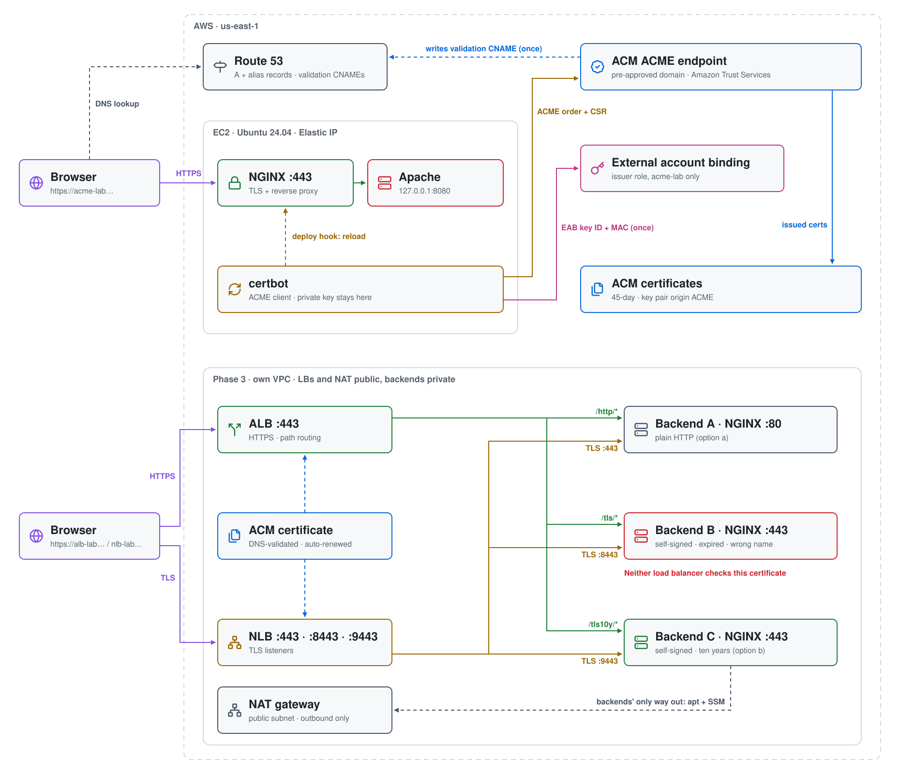

# AWS ACM ACME — certbot, NGINX and Apache on EC2

This project shows **AWS Certificate Manager's ACME endpoint** issuing a
publicly trusted certificate straight onto a server you run. **certbot** on a
small EC2 instance requests the certificate from ACM, **NGINX** serves it on
port 443, and **Apache** produces the page behind it on `127.0.0.1:8080`.

The private key is generated on the instance and **never leaves it**. ACM still
records every certificate in its inventory, with a stable ARN across renewals.

It uses **Terraform** (the `aws` and `awscc` providers) and a few shell scripts
to build, prove, renew and tear down the lab.

<picture>
  <source media="(prefers-color-scheme: dark)" srcset="architecture-dark.svg">
  
</picture>

Regenerate the diagrams with `python make_diagram.py`.

## How it works

ACM's ACME support splits the job in two:

* **The administrator (phase 1, `01-acme/`)** creates an **ACME endpoint**,
  approves the domain once with a **domain validation**, and creates an
  **external account binding (EAB)** tied to an IAM role.
* **The server (phase 2, `02-server/`)** runs an ordinary ACME client
  (certbot) against the endpoint's directory URL, the same way it would talk to
  Let's Encrypt.

The steps, in order:

1. **Endpoint.** `awscc_certificatemanager_acme_endpoint` creates a managed ACME
   server with `PRE_APPROVED` authorization and gives back a directory URL like
   `https://acm-acme-enroll.us-east-1.api.aws/<id>/directory`.
2. **Domain validation.** `awscc_certificatemanager_acme_domain_validation`
   approves exactly `acme-lab.mikes-cloud-solutions.com` (no apex, no other
   subdomains, no wildcards). Because the hosted zone ID is given, ACM writes
   the validation CNAME into Route 53 itself. It turns `VALID` in about a
   minute.
3. **Binding.** `awscc_certificatemanager_acme_external_account_binding`
   produces a key ID and MAC key. ACM assumes the binding's **issuer role**
   whenever certbot issues or revokes, and that role may only request
   certificates for the one demo name (`acm:DomainNames` condition).
4. **Server.** At boot the instance reads the EAB key ID and MAC key from ACM
   with its own instance role. They never appear in user data, Terraform state
   or outputs. certbot uses them **once** to register its ACME account.
5. **Issue.** certbot sends an order and a CSR. The domain is already
   approved, so there is **no HTTP-01 or DNS-01 challenge**: port 80 stays
   closed and certbot never touches DNS. ACM issues within about two minutes.
6. **Serve.** NGINX starts on 443 with the certificate and proxies to Apache.
   A certbot deploy hook reloads NGINX after every issuance and renewal.

### What the certificate looks like

| | |
|---|---|
| Issuer | Amazon (`Amazon ECDSA 256 S…`), Amazon Trust Services chain |
| Key | ECDSA P-256, generated by certbot on the instance |
| Validity | **45 days** (renewed by certbot, not by ACM) |
| In ACM | Listed with `CertificateKeyPairOrigin = ACME` |
| ARN | Stays the same when the same ACME account renews the same names |

### Limits to know

* ACME certificates **cannot** be attached to ELB, CloudFront or API Gateway;
  AWS never holds the key. Use a normal ACM certificate for those.
* `ExportCertificate`, `RenewCertificate` and `RevokeCertificate` do not apply.
  Revocation goes through the ACME endpoint (`certbot revoke`).
* ACM will not **delete** an ACME certificate before it expires. It removes it
  by itself one year after expiry.
* `hashicorp/aws` has no ACME resources yet, so phase 1 uses the `awscc`
  provider for the three ACME resources.

## Prerequisites

* [An AWS Account](https://aws.amazon.com/console/)
* A **public Route 53 hosted zone** for your domain, delegated from the
  registrar. This lab uses `mikes-cloud-solutions.com`; change `zone_name` and
  `host_name` in `01-acme/main.tf` for your own.
* [AWS CLI](https://docs.aws.amazon.com/cli/latest/userguide/getting-started-install.html)
* [Terraform](https://developer.hashicorp.com/terraform/install)
* `jq`, `openssl`, `curl` and `dig` in PATH

`check_env.sh` checks all of these, and confirms that public DNS for the zone
points at the Route 53 name servers.

## Download

```bash
git clone https://github.com/mamonaco1973/aws-acme.git
cd aws-acme
```

## Deploy

```bash
./apply.sh
```

`apply.sh`:
1. `check_env.sh`: tools, AWS credentials, hosted zone and delegation.
2. `terraform apply` in `01-acme/`: endpoint, domain validation, issuer role
   and EAB. Waits until the domain validation is `VALID`.
3. `terraform apply` in `02-server/`: VPC, security group (443 only), EC2
   instance, Elastic IP and the `acme-lab` A record.
4. Waits, through SSM Run Command, for the instance to finish its user data:
   packages, certificate, NGINX.
5. `validate.sh`.

Total time is about 4 minutes.

## Validate

```bash
./validate.sh
```

```
============================================================================
ACM ACME Lab - Validation Output
============================================================================

NOTE: Site URL:          https://acme-lab.mikes-cloud-solutions.com
NOTE: Response:          Served by Apache through NGINX
NOTE: Issuer:            C=US, O=Amazon, CN=Amazon ECDSA 256 S13
NOTE: Serial:            435BFD7E229C2D0A79240C00C8AEB6B7
NOTE: Not after:         Jan  2 15:23:34 2027 GMT
NOTE: ACM certificate:   arn:aws:acm:us-east-1:<account>:certificate/<id>
NOTE: Key pair origin:   ACME
```

The page itself shows what Apache received from NGINX: Apache sees the client
as `127.0.0.1`, while `X-Real-IP`, `X-Forwarded-Proto`, the TLS protocol and
the cipher come from NGINX. It also shows the names, issuer, serial and dates
of the certificate NGINX is serving.

Check the certificate yourself from anywhere:

```bash
host=acme-lab.mikes-cloud-solutions.com
openssl s_client -connect "$host:443" -servername "$host" </dev/null 2>/dev/null |
  openssl x509 -noout -issuer -serial -enddate
```

## Renew live

```bash
./renew.sh
```

Forces one `certbot renew` on the instance through SSM, then shows the
rotation:

```
NOTE: Serial before:   435BFD7E229C2D0A79240C00C8AEB6B7
NOTE: ACM ARN before:  arn:aws:acm:us-east-1:<account>:certificate/8d074e6d-…

NOTE: Forcing certbot renewal on i-0….
NOTE: certbot renewal succeeded.

NOTE: Serial after:    449852B1D9796DDC0134E54F827B545A
NOTE: ACM ARN after:   arn:aws:acm:us-east-1:<account>:certificate/8d074e6d-…

NOTE: NGINX is serving the renewed certificate.
NOTE: ACM kept the same certificate ARN across the renewal.
NOTE: The page still loads: Served by Apache through NGINX.
```

Without `renew.sh`, Ubuntu's `certbot.timer` renews the 45-day certificate
automatically when it has 30 days left. No EAB is needed for renewals: certbot
reuses the ACME account it registered, which keeps working after the 1-day EAB
expires.

## Teardown

```bash
./destroy.sh
```

1. Revokes the certificate through the ACME endpoint (`certbot revoke`, via
   SSM), since its private key is about to be destroyed.
2. Destroys `02-server/`, then `01-acme/`. Deleting the endpoint also deletes
   its domain validation, and ACM removes the validation CNAME.
3. Tries to delete the lab's certificates from ACM. ACM refuses for ACME
   certificates that have not expired. They stay listed as `REVOKED` and are
   removed automatically a year after expiry.
4. Deletes any validation CNAME ACM left under `acme-lab`.

The hosted zone and its other records are never touched.

## Cost

* **ACM:** ACME certificates are billed **per domain name at issuance**, with
  volume tiers. Every `apply.sh` and every `renew.sh` is one issuance for one
  name. See [ACM pricing](https://aws.amazon.com/certificate-manager/pricing/).
* **EC2:** one `t3.micro`, an 8 GiB gp3 volume and an Elastic IP while the lab
  is up.
* **Route 53:** the hosted zone you already have, plus queries.

## Files

| Path | Purpose |
|------|---------|
| `01-acme/acme.tf` | ACME endpoint, domain validation, EAB (`awscc`) |
| `01-acme/role.tf` | Issuer role ACM assumes, limited to the demo name |
| `02-server/network.tf` | VPC, public subnet, security group (443 only) |
| `02-server/role.tf` | Instance role: SSM + read this one EAB |
| `02-server/server.tf` | Ubuntu 24.04 instance, Elastic IP, A record |
| `02-server/scripts/userdata.sh.tpl` | Apache, certbot, deploy hook, NGINX |
| `apply.sh` / `validate.sh` / `renew.sh` / `destroy.sh` | Lab lifecycle |
| `make_diagram.py` | Regenerates `architecture-{light,dark}.svg` |

## Notes from building it

* **certbot comes from apt, not snap.** Ubuntu 24.04's certbot 2.9 already has
  `--eab-kid`, `--eab-hmac-key` and `--issuance-timeout`, and ships
  `certbot.timer`. The snap store refused connections during early boot often
  enough to break the build, so nothing here uses snap. The AWS CLI v2 comes
  from AWS's own installer.
* **Allow two minutes to issue.** ACM can take up to 120 seconds to issue, which
  is longer than many ACME clients wait by default; the lab passes
  `--issuance-timeout 120`.
* **The certificate has no subject CN.** The host name is only in the Subject
  Alternative Name, so the page and `validate.sh` show the SAN instead.
